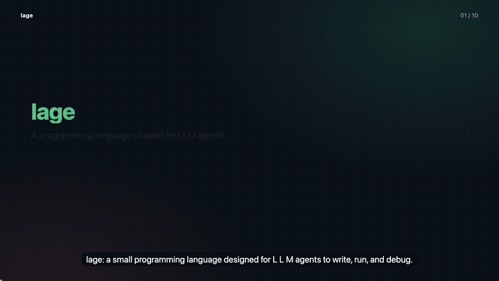
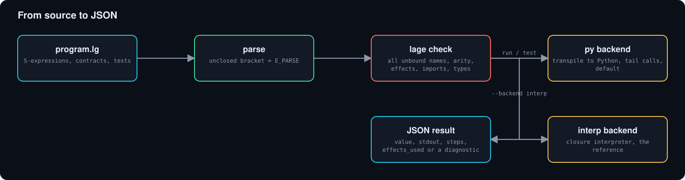
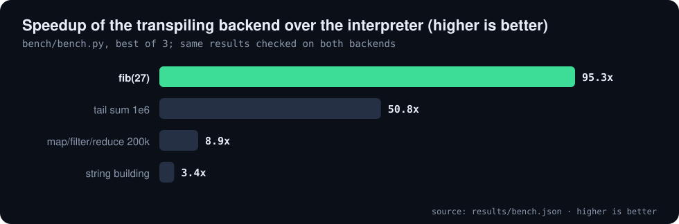

<div align="center">



# 🧬 lage

**A small programming language designed for LLM agents to write, run and debug**

     [](https://github.com/Bobliuuu/lage/releases/tag/v0.1.0)

[🎬 Video](#video) · [🧑‍💻 Example](#example) · [🤖 Agent-shaped](#why-it-is-agent-shaped) · [⚡ Speed](#speed) · [📚 Stdlib](#standard-library) · [🚀 Use](#use) · [⚠️ Status](#status) · [🗺️ Repo map](#repo-map)

</div>

---

**Explainer video (with voice-over and subtitles): why an agent-shaped language, how it behaves, and what we measured**

[](video/lage_explainer.mp4)

<a id="video"></a>
**lage** is a small language built around how an LLM agent actually fails: syntax slips, hidden side effects, one-error-per-run fix loops, free-text stack traces,
runaway loops. One S-expression grammar, declared **effects**, **contracts** and inline **tests** next to the code, optional gradual **types**, a whole-program
**checker** that reports every problem at once, and **JSON diagnostics** for every failure. The reference implementation is Python, standard library only; files use the `.lg` extension.

<a id="example"></a>

## 🧑‍💻 Example

```lisp
(defn fact [n]
  "factorial"
  (requires (>= n 0))
  (ensures (>= result 1))
  (if (<= n 1) 1 (* n (fact (- n 1)))))

(test "fact 5" (= (fact 5) 120))
```
On a deliberately broken program, `lage check examples/broken.lg --json` reports **3 diagnostics in one pass** (unbound names with did-you-mean hints, wrong arity).

<p align="center"></p>

<a id="why-it-is-agent-shaped"></a>

## 🤖 Why it is agent-shaped

| Agent problem | lage answer |
|---|---|
| Syntax slips (indentation, precedence, quoting) | One S-expression grammar. Whitespace-insensitive, no operators, no precedence. Brackets are the only structure, so truncated output is detected as `E_PARSE unclosed '('`. |
| Hidden side effects | Effects (`fs.read`, `fs.write`, `net`, `time`) must be declared per function **and** granted per run: `--allow fs.read`. `--json` reports `effects_used`. |
| "Does it work?" needs a harness | `requires` / `ensures` contracts and `(test ...)` forms live beside the code. `lage test` reports `left` / `right` on failed `=`. |
| Free-text stack traces | Every failure is a JSON diagnostic: `code`, `line`, `col`, `source`, `hint` (e.g. `did you mean: print`), compressed `stack`. |
| One error per run, slow fix loops | `lage check` reports **every** unbound name (with suggestions), wrong arity, undeclared effect, bad form and bad import in one pass, before anything executes. `run` and `test` do this first. |
| Wrong-type bugs that only show at runtime | Optional gradual types: `(sig [int (list str)] (result int str))`. Generics via lowercase type variables, `nil`-safety (`(if c 1 nil)` is not an `int`), result/`?`/`match` checking, builtin signatures. Unannotated code is never an error source; types are static only. |
| Runaway loops | Fuel budget (`--fuel`) and a call-depth cap. `E_FUEL` / `E_DEPTH`, never a hang. Tail calls run in constant depth. |
| Growing past one file | `(import "lib/m.lg" :as m)` with `m/name` calls. Imports are confined to the entry file's directory, cycles are errors, `_private` names stay private, the checker follows imports. |
| Variadic / optional params | `(defn f [a (b 10) & more] ...)`: `(b 10)` is optional (default evaluated per call, sees earlier params), `& more` collects the rest into a list; `(sig [int int & str] int)` types them. |
| Exceptions to forget | No exceptions. Fallible builtins return `(ok v)` / `(err e)`; `(? r)` propagates. |
| Non-determinism | Maps keep insertion order; no hidden clocks or randomness (`now` is an effect). |
| Style drift between edits | `lage fmt` is canonical and idempotent. |
| Needing docs in context | `lage ref` prints the whole language in one screen. |

<p align="center"></p>

<a id="speed"></a>

## ⚡ Speed

The default backend transpiles lage to Python source and execs it; the closure interpreter stays as the reference (`--backend interp`) and the two are differential-tested on 130+ programs. Produced by `python3 bench/bench.py` (best of 3), recorded in [`results/bench.json`](results/bench.json).

| Fastest speedup | Slowest speedup | fib(27) interp | fib(27) py |
|:---:|:---:|:---:|:---:|
| **95x** | **3.4x** | **6.0 s** | **0.06 s** |

**Interpreter versus transpiling backend (best of 3, parse + compile + run)**

| Case | interp (s) | py (s) | Speedup |
| :--- | ---: | ---: | ---: |
| **fib(27)** | **6.004** | **0.063** | **95.3x** |
| tail sum 1e6 | 4.574 | 0.090 | 50.8x |
| map/filter/reduce 200k | 0.753 | 0.085 | 8.9x |
| string building | 0.167 | 0.049 | 3.4x |

<sub>Source: `results/bench.json`</sub>

<p align="center"></p>

Timings are from a shared, heavily loaded laptop: trust the ratios, expect different absolute seconds on your machine.

<a id="standard-library"></a>

## 📚 Standard library

Pure-lage modules, bundled: `(import "std/list" :as l)` then `(l/zip xs ys)`. Function list: [`lage/std/README.md`](lage/std/README.md); known limits: [`lage/std/LIMITATIONS.md`](lage/std/LIMITATIONS.md).

**Bundled standard library (pure lage)**

| Module | Public functions |
| :--- | ---: |
| std/json | 2 |
| std/list | 25 |
| std/map | 12 |
| std/math | 12 |
| std/result | 8 |
| std/str | 12 |

<sub>Source: `results/readme_data.json`</sub>

<a id="use"></a>

## 🚀 Use

```sh
python3 -m lage ref                          # the language, one screen
python3 -m lage check examples/use_lib.lg --json
python3 -m lage run examples/hello.lg
python3 -m lage test examples/hello.lg --json
python3 -m lage run examples/files.lg --allow fs.read --json
echo '(+ 1 2)' | python3 -m lage run - --json
python3 -m lage fmt examples/hello.lg --check
python3 -m unittest discover -s tests
```
`--json` on `run` prints one object, `{"ok":true,"value":..,"stdout":..,"steps":..,"effects_used":[..]}`
or `{"ok":false,"error":{"code":"E_UNBOUND","message":..,"line":1,"col":2,"hint":..}}`.
Exit codes: 0 ok, 1 runtime or test failure, 2 parse or usage error.

<a id="status"></a>

## 📌 Status

Transpiling backend with tail calls and no practical nesting limit, gradual static types, a fully type-annotated stdlib, rest and optional parameters, modules,
whole-program static checker, `lage api`, formatter, test runner, 323 tests (run on both backends), 4,113 lines of Python.
Not yet: native/bytecode compilation beyond Python; lage `fn`s nested ~100 deep (Python indentation limit).

<a id="quick-start"></a>

## 🚀 Quick start

**Regenerate the numbers, README and video**

```bash
python3 tools/readme_data.py
python3 ~/video-readme-maker/vrm.py all README.spec.yml
```

<a id="caveats"></a>

## ⚠️ Honest caveats

- Reference implementation in Python; no native or bytecode compilation yet.
- Benchmarks ran on a shared, loaded laptop; compare the ratios, not the absolute seconds.
- lage `fn`s nested more than about 90 deep inside functions need `--backend interp`.
- Types are gradual and static only; unannotated code is never an error source.

<a id="repo-map"></a>

## 🗺️ Repo map

| Path | What it is |
|---|---|
| `lage/` | the language: parser and interpreter (core), Python-transpiling backend (pyback), checker, types, CLI, `ref`, `api` |
| `lage/std/` | bundled pure-lage standard library |
| `examples/` | hello (contracts + tests), files (effects), typed and imported libraries, broken (checker demo) |
| `tests/` | unit tests, run on both backends |
| `bench/bench.py` | interpreter versus transpiling backend |
| `results/` | bench.json and readme_data.json: source of every number here |
| `tools/readme_data.py` | runs bench, tests and the CLI and writes results/ |
| `video/` | explainer mp4, poster, preview gif, subtitles |
| `assets/` | generated hero, chart and diagram SVGs |

---

<div align="center"><sub>Generated with [video-readme-maker](https://github.com/Bobliuuu/video-readme-maker).</sub></div>
